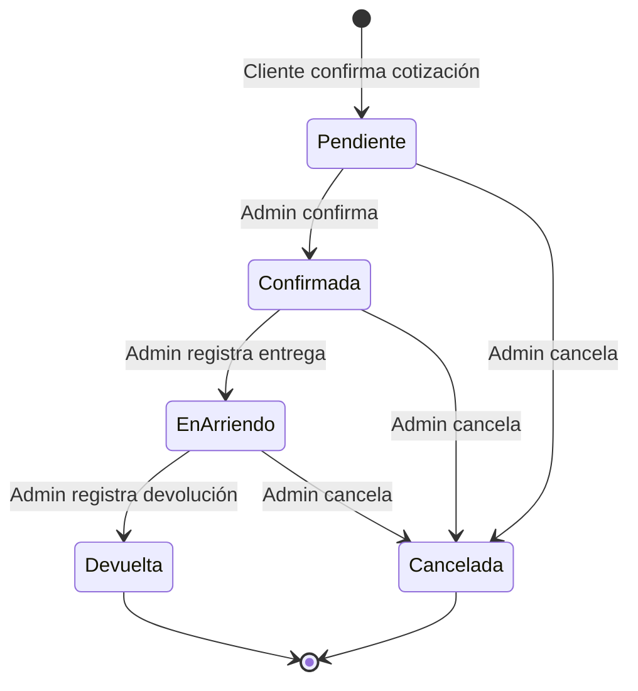

# Punto Cumbre — Especificaciones Gherkin

> Documento maestro de escenarios BDD para la plataforma de arriendo de equipos de montaña **Punto Cumbre**.
> Todos los escenarios están escritos en español siguiendo el formato Given/When/Then (Dado/Cuando/Entonces).

---

## Tabla de Contenidos

1. [Módulo Catálogo (HU01, HU02)](#1-módulo-catálogo-hu01-hu02)
2. [Módulo Disponibilidad (HU03)](#2-módulo-disponibilidad-hu03)
3. [Módulo Cotización (HU04, HU05)](#3-módulo-cotización-hu04-hu05)
4. [Módulo Reservas (HU10, HU12)](#4-módulo-reservas-hu10-hu12)
5. [Módulo Administración (HU07, HU08, HU09)](#5-módulo-administración-hu07-hu08-hu09)
6. [Módulo Reparación (HU06)](#6-módulo-reparación-hu06)
7. [Módulo Notificaciones (HU11)](#7-módulo-notificaciones-hu11)

---

## 1. Módulo Catálogo (HU01, HU02)

### Feature: Catálogo categorizado de equipos

```gherkin
# language: es

Característica: Catálogo categorizado de equipos
  Como cliente
  Quiero ver el catálogo de equipos organizado por categorías
  Para encontrar rápidamente el equipo de montaña que necesito

  # ── Caminos felices ──

  Escenario: Ver todas las categorías disponibles
    Dado que existen las categorías "Crampones y piolets", "Carpas", "Sacos de dormir"
    Cuando el cliente accede a la página del catálogo
    Entonces se muestran las 3 categorías disponibles
    Y cada categoría muestra su nombre e imagen representativa

  Escenario: Ver equipos de una categoría específica
    Dado que la categoría "Crampones y piolets" tiene 5 equipos registrados
    Cuando el cliente selecciona la categoría "Crampones y piolets"
    Entonces se muestran los 5 equipos de esa categoría
    Y cada equipo muestra su nombre, imagen principal y precio por día

  Escenario: Navegar entre categorías
    Dado que el cliente está viendo los equipos de la categoría "Carpas"
    Cuando el cliente selecciona la categoría "Sacos de dormir"
    Entonces se muestran los equipos de la categoría "Sacos de dormir"
    Y la categoría "Sacos de dormir" aparece como seleccionada

  Escenario: Ver catálogo completo sin filtro de categoría
    Dado que existen 15 equipos repartidos en 3 categorías
    Cuando el cliente accede al catálogo sin seleccionar ninguna categoría
    Entonces se muestran los 15 equipos disponibles
    Y cada equipo indica a qué categoría pertenece

  # ── Estados vacíos ──

  Escenario: Catálogo sin equipos registrados
    Dado que no existen equipos registrados en el sistema
    Cuando el cliente accede a la página del catálogo
    Entonces se muestra un mensaje "No hay equipos disponibles en este momento"
    Y no se muestran tarjetas de equipos

  Escenario: Categoría sin equipos
    Dado que la categoría "Bastones de trekking" existe pero no tiene equipos asignados
    Cuando el cliente selecciona la categoría "Bastones de trekking"
    Entonces se muestra un mensaje "No hay equipos en esta categoría"
    Y se sugiere al cliente explorar otras categorías

  Escenario: No existen categorías creadas
    Dado que no existen categorías registradas en el sistema
    Cuando el cliente accede a la página del catálogo
    Entonces se muestra un mensaje indicando que el catálogo está vacío
    Y no se muestran filtros de categoría
```

### Feature: Ficha técnica del equipo

```gherkin
# language: es

Característica: Ficha técnica del equipo
  Como cliente
  Quiero ver la ficha técnica completa de un equipo
  Para conocer sus características, precio y condiciones de arriendo antes de solicitar una cotización

  # ── Caminos felices ──

  Escenario: Ver ficha técnica completa de un equipo
    Dado que existe el equipo "Crampón Grivel G12" con los siguientes datos:
      | campo               | valor                                  |
      | nombre              | Crampón Grivel G12                     |
      | descripción         | Crampón técnico de 12 puntas           |
      | precio_por_día      | 8000                                   |
      | categoría           | Crampones y piolets                    |
      | características     | Material: acero, Peso: 950g, Puntas: 12 |
      | condiciones_arriendo| Requiere devolución limpio y seco      |
    Cuando el cliente selecciona el equipo "Crampón Grivel G12"
    Entonces se muestra la ficha técnica con el nombre "Crampón Grivel G12"
    Y se muestra la descripción "Crampón técnico de 12 puntas"
    Y se muestra el precio "$8.000 por día"
    Y se muestran las características técnicas del equipo
    Y se muestran las condiciones de arriendo

  Escenario: Ver imágenes del equipo en la ficha técnica
    Dado que el equipo "Carpa Doite Kailas 3" tiene 3 imágenes cargadas
    Cuando el cliente accede a la ficha técnica del equipo
    Entonces se muestran las 3 imágenes del equipo
    Y la primera imagen se muestra como imagen principal
    Y el cliente puede navegar entre las imágenes

  Escenario: Equipo con una sola imagen
    Dado que el equipo "Piolet Petzl Summit" tiene 1 imagen cargada
    Cuando el cliente accede a la ficha técnica del equipo
    Entonces se muestra la imagen del equipo como imagen principal
    Y no se muestran controles de navegación entre imágenes

  Escenario: Volver al catálogo desde la ficha técnica
    Dado que el cliente está viendo la ficha técnica del equipo "Saco de dormir -10°C"
    Y el cliente llegó desde la categoría "Sacos de dormir"
    Cuando el cliente presiona el botón "Volver al catálogo"
    Entonces el cliente es redirigido a la vista de la categoría "Sacos de dormir"

  # ── Casos borde ──

  Escenario: Equipo sin imágenes cargadas
    Dado que el equipo "Bastón trekking aluminio" no tiene imágenes cargadas
    Cuando el cliente accede a la ficha técnica del equipo
    Entonces se muestra una imagen de marcador de posición genérica
    Y el resto de la información del equipo se muestra normalmente

  Escenario: Acceder a ficha de equipo inexistente
    Dado que no existe un equipo con el identificador "equipo-999"
    Cuando el cliente intenta acceder a la ficha técnica con identificador "equipo-999"
    Entonces se muestra un mensaje de error "Equipo no encontrado"
    Y se ofrece un enlace para volver al catálogo
```

---

## 2. Módulo Disponibilidad (HU03)

### Feature: Consulta de disponibilidad por fechas

```gherkin
# language: es

Característica: Consulta de disponibilidad por fechas
  Como cliente
  Quiero seleccionar fechas de retiro y devolución
  Para verificar si el equipo que necesito está disponible en esas fechas

  # ── Caminos felices ──

  Escenario: Equipo completamente disponible
    Dado que el equipo "Crampón Grivel G12" tiene 5 unidades en stock
    Y no existen reservas para el rango del 15 al 20 de enero de 2027
    Cuando el cliente consulta disponibilidad del 15 al 20 de enero de 2027
    Entonces el sistema indica que el equipo está "Disponible"
    Y se muestran 5 unidades disponibles para esas fechas
    Y se muestra el precio estimado por 5 días de arriendo

  Escenario: Equipo parcialmente disponible
    Dado que el equipo "Carpa Doite Kailas 3" tiene 3 unidades en stock
    Y existen reservas que ocupan 2 unidades del 10 al 15 de febrero de 2027
    Cuando el cliente consulta disponibilidad del 10 al 15 de febrero de 2027
    Entonces el sistema indica que el equipo tiene "Disponibilidad parcial"
    Y se muestra que hay 1 unidad disponible de 3

  Escenario: Equipo no disponible
    Dado que el equipo "Piolet Petzl Summit" tiene 2 unidades en stock
    Y existen reservas que ocupan las 2 unidades del 1 al 5 de marzo de 2027
    Cuando el cliente consulta disponibilidad del 1 al 5 de marzo de 2027
    Entonces el sistema indica que el equipo está "No disponible"
    Y se muestra un mensaje sugiriendo intentar con otras fechas

  Escenario: Consultar disponibilidad para un solo día
    Dado que el equipo "Bastón trekking carbono" tiene 4 unidades en stock
    Y no existen reservas para el 20 de enero de 2027
    Cuando el cliente consulta disponibilidad para el 20 de enero de 2027 (retiro y devolución el mismo día)
    Entonces el sistema indica que el equipo está "Disponible"
    Y se muestra el precio estimado por 1 día de arriendo

  Escenario: Consultar disponibilidad de múltiples equipos
    Dado que el cliente ha seleccionado los equipos "Crampón Grivel G12" y "Piolet Petzl Summit"
    Cuando el cliente consulta disponibilidad para el rango del 5 al 10 de abril de 2027
    Entonces se muestra la disponibilidad individual de cada equipo para esas fechas
    Y se indica qué equipos están disponibles y cuáles no

  # ── Validaciones de fechas ──

  Escenario: Fecha de retiro en el pasado
    Dado que la fecha actual es 15 de enero de 2027
    Cuando el cliente intenta consultar disponibilidad con fecha de retiro 10 de enero de 2027
    Entonces el sistema muestra un error "La fecha de retiro no puede ser anterior a hoy"
    Y no se realiza la consulta de disponibilidad

  Escenario: Fecha de devolución anterior a la de retiro
    Dado que el cliente selecciona fecha de retiro 20 de enero de 2027
    Cuando el cliente selecciona fecha de devolución 18 de enero de 2027
    Entonces el sistema muestra un error "La fecha de devolución debe ser igual o posterior a la fecha de retiro"
    Y no se realiza la consulta de disponibilidad

  Escenario: Rango de fechas excesivamente largo
    Dado que el sistema tiene un límite máximo de arriendo de 30 días
    Cuando el cliente intenta consultar disponibilidad por un rango de 45 días
    Entonces el sistema muestra un error "El período máximo de arriendo es de 30 días"
    Y no se realiza la consulta de disponibilidad

  Escenario: No se seleccionan fechas
    Dado que el cliente está en la página de consulta de disponibilidad
    Cuando el cliente intenta consultar disponibilidad sin seleccionar fechas
    Entonces el sistema muestra un error "Debe seleccionar fechas de retiro y devolución"
    Y el botón de consulta permanece deshabilitado

  # ── Casos borde ──

  Escenario: Disponibilidad al borde de una reserva existente
    Dado que el equipo "Carpa Doite Kailas 3" tiene 1 unidad en stock
    Y existe una reserva confirmada del 10 al 15 de enero de 2027
    Cuando el cliente consulta disponibilidad del 16 al 20 de enero de 2027
    Entonces el sistema indica que el equipo está "Disponible"
    Y se muestra 1 unidad disponible

  Escenario: Disponibilidad cuando la reserva existente está cancelada
    Dado que el equipo "Crampón Grivel G12" tiene 1 unidad en stock
    Y existe una reserva cancelada del 10 al 15 de enero de 2027
    Cuando el cliente consulta disponibilidad del 10 al 15 de enero de 2027
    Entonces el sistema indica que el equipo está "Disponible"
    Y las reservas canceladas no cuentan como ocupación de stock
```

---

## 3. Módulo Cotización (HU04, HU05)

### Feature: Solicitud de cotización

```gherkin
# language: es

Característica: Solicitud de cotización
  Como cliente
  Quiero solicitar una cotización indicando los equipos que necesito, las fechas y mis datos de contacto
  Para recibir un presupuesto detallado del arriendo

  # ── Caminos felices ──

  Escenario: Solicitar cotización con un solo equipo
    Dado que el equipo "Crampón Grivel G12" está disponible del 15 al 20 de enero de 2027
    Y el equipo tiene un precio por día de $8.000
    Cuando el cliente completa el formulario de cotización con:
      | campo            | valor                    |
      | nombre           | Juan Pérez               |
      | email            | juan.perez@email.com     |
      | teléfono         | +56912345678             |
      | equipo           | Crampón Grivel G12       |
      | cantidad         | 1                        |
      | fecha_retiro     | 2027-01-15               |
      | fecha_devolución | 2027-01-20               |
    Y envía la solicitud de cotización
    Entonces el sistema genera una cotización automática
    Y el precio total calculado es $40.000 (8.000 × 5 días)
    Y el cliente ve el resumen de la cotización

  Escenario: Solicitar cotización con múltiples equipos
    Dado que los siguientes equipos están disponibles del 10 al 15 de febrero de 2027:
      | equipo                | precio_por_día | cantidad |
      | Crampón Grivel G12    | 8000           | 2        |
      | Piolet Petzl Summit   | 10000          | 1        |
      | Casco escalada Petzl  | 5000           | 2        |
    Cuando el cliente completa el formulario de cotización con:
      | campo            | valor                    |
      | nombre           | María González           |
      | email            | maria@email.com          |
      | teléfono         | +56987654321             |
      | fecha_retiro     | 2027-02-10               |
      | fecha_devolución | 2027-02-15               |
    Y agrega los 3 equipos con sus cantidades a la cotización
    Y envía la solicitud de cotización
    Entonces el sistema genera una cotización automática con el desglose:
      | equipo                | precio_día | cantidad | días | subtotal |
      | Crampón Grivel G12    | 8000       | 2        | 5    | 80000    |
      | Piolet Petzl Summit   | 10000      | 1        | 5    | 50000    |
      | Casco escalada Petzl  | 5000       | 2        | 5    | 50000    |
    Y el precio total de la cotización es $180.000

  Escenario: Cotización de un solo día
    Dado que el equipo "Bastón trekking carbono" está disponible el 20 de marzo de 2027
    Y el equipo tiene un precio por día de $4.000
    Cuando el cliente solicita una cotización con fecha de retiro y devolución el 20 de marzo de 2027
    Y selecciona 1 unidad del equipo
    Y envía la solicitud de cotización
    Entonces el sistema calcula el precio total como $4.000 (4.000 × 1 día)

  # ── Validaciones de datos del cliente ──

  Escenario: Enviar cotización sin nombre
    Dado que el cliente está en el formulario de cotización
    Cuando el cliente envía la solicitud sin completar el campo "nombre"
    Entonces el sistema muestra un error "El nombre es obligatorio"
    Y la cotización no se genera

  Escenario: Enviar cotización con email inválido
    Dado que el cliente está en el formulario de cotización
    Cuando el cliente ingresa "correo-invalido" en el campo email
    Y envía la solicitud de cotización
    Entonces el sistema muestra un error "Debe ingresar un email válido"
    Y la cotización no se genera

  Escenario: Enviar cotización sin teléfono
    Dado que el cliente está en el formulario de cotización
    Cuando el cliente envía la solicitud sin completar el campo "teléfono"
    Entonces el sistema muestra un error "El teléfono es obligatorio"
    Y la cotización no se genera

  Escenario: Enviar cotización sin email
    Dado que el cliente está en el formulario de cotización
    Cuando el cliente envía la solicitud sin completar el campo "email"
    Entonces el sistema muestra un error "El email es obligatorio"
    Y la cotización no se genera

  Escenario: Enviar cotización sin equipos seleccionados
    Dado que el cliente ha completado sus datos de contacto
    Y no ha seleccionado ningún equipo
    Cuando el cliente intenta enviar la solicitud de cotización
    Entonces el sistema muestra un error "Debe seleccionar al menos un equipo"
    Y la cotización no se genera

  Escenario: Enviar cotización sin fechas seleccionadas
    Dado que el cliente ha completado sus datos de contacto
    Y ha seleccionado al menos un equipo
    Pero no ha seleccionado fechas de retiro y devolución
    Cuando el cliente intenta enviar la solicitud de cotización
    Entonces el sistema muestra un error "Debe seleccionar fechas de retiro y devolución"
    Y la cotización no se genera

  # ── Casos borde ──

  Escenario: Solicitar cotización de equipo que ya no está disponible
    Dado que el equipo "Carpa Doite Kailas 3" tenía disponibilidad del 5 al 10 de abril de 2027
    Pero otro cliente reservó la última unidad mientras se completaba el formulario
    Cuando el cliente envía la solicitud de cotización para ese equipo y fechas
    Entonces el sistema muestra un error "El equipo 'Carpa Doite Kailas 3' ya no está disponible para las fechas seleccionadas"
    Y la cotización no se genera

  Escenario: Solicitar cantidad mayor al stock disponible
    Dado que el equipo "Crampón Grivel G12" tiene 3 unidades disponibles del 1 al 5 de mayo de 2027
    Cuando el cliente solicita 5 unidades en la cotización
    Entonces el sistema muestra un error "Solo hay 3 unidades disponibles del equipo 'Crampón Grivel G12' para las fechas seleccionadas"
    Y la cotización no se genera
```

### Feature: Resumen y confirmación de cotización

```gherkin
# language: es

Característica: Resumen y confirmación de cotización
  Como cliente
  Quiero ver un resumen detallado de mi cotización y poder confirmarla
  Para convertirla en una reserva de arriendo

  # ── Caminos felices ──

  Escenario: Ver resumen de cotización generada
    Dado que se ha generado una cotización con los siguientes datos:
      | campo            | valor                          |
      | código           | COT-2027-0001                  |
      | cliente          | Juan Pérez                     |
      | email            | juan.perez@email.com           |
      | teléfono         | +56912345678                   |
      | fecha_retiro     | 15 de enero de 2027            |
      | fecha_devolución | 20 de enero de 2027            |
      | total            | $40.000                        |
    Y contiene el equipo "Crampón Grivel G12" (1 unidad × 5 días × $8.000 = $40.000)
    Cuando el cliente visualiza el resumen de la cotización
    Entonces se muestran todos los datos del cliente
    Y se muestran las fechas de retiro y devolución
    Y se muestra el desglose de equipos con precios unitarios, cantidades, días y subtotales
    Y se muestra el total general de $40.000
    Y se muestra un botón para "Confirmar cotización"

  Escenario: Confirmar cotización y crear reserva
    Dado que el cliente "Juan Pérez" tiene la cotización "COT-2027-0001" por $40.000
    Y la cotización está en estado válido
    Cuando el cliente presiona "Confirmar cotización"
    Entonces se crea una reserva con estado "Pendiente"
    Y se genera un código de reserva único (ejemplo: "RES-2027-0001")
    Y se muestra al cliente el código de reserva
    Y se muestra un mensaje "Su reserva ha sido creada exitosamente"
    Y se indica que puede consultar el estado con su código de reserva o email

  Escenario: Resumen de cotización con múltiples equipos
    Dado que se ha generado una cotización con 3 equipos diferentes
    Cuando el cliente visualiza el resumen de la cotización
    Entonces se muestra una tabla con cada equipo en una fila separada
    Y cada fila muestra: nombre del equipo, cantidad, precio por día, días, subtotal
    Y se muestra el total general sumando todos los subtotales

  # ── Casos borde ──

  Escenario: Intentar confirmar cotización expirada
    Dado que la cotización "COT-2027-0001" fue generada hace más de 24 horas
    Cuando el cliente intenta confirmar la cotización
    Entonces el sistema muestra un mensaje "Esta cotización ha expirado"
    Y se sugiere al cliente generar una nueva cotización
    Y la reserva no se crea

  Escenario: Intentar confirmar cotización ya confirmada
    Dado que la cotización "COT-2027-0001" ya fue confirmada previamente
    Y se creó la reserva "RES-2027-0001"
    Cuando el cliente intenta confirmar la cotización nuevamente
    Entonces el sistema muestra un mensaje "Esta cotización ya fue confirmada"
    Y se muestra el código de reserva existente "RES-2027-0001"
    Y no se crea una nueva reserva

  Escenario: Confirmar cotización cuando la disponibilidad cambió
    Dado que la cotización "COT-2027-0002" incluye el equipo "Carpa Doite Kailas 3"
    Y desde que se generó la cotización, ese equipo fue reservado por otro cliente
    Cuando el cliente intenta confirmar la cotización
    Entonces el sistema muestra un error "La disponibilidad de algunos equipos ha cambiado"
    Y se indica qué equipos ya no están disponibles
    Y la reserva no se crea
```

---

## 4. Módulo Reservas (HU10, HU12)

### Feature: Consulta de reservas por el cliente

```gherkin
# language: es

Característica: Consulta de reservas por el cliente
  Como cliente
  Quiero consultar el estado de mis reservas usando mi código de reserva o email
  Para hacer seguimiento de mis arriendos actuales y pasados

  # ── Caminos felices ──

  Escenario: Consultar reserva por código de reserva
    Dado que existe la reserva "RES-2027-0001" con estado "Confirmada"
    Y pertenece al cliente "Juan Pérez" con email "juan.perez@email.com"
    Cuando el cliente ingresa el código "RES-2027-0001" en el formulario de consulta
    Entonces se muestra el detalle de la reserva con:
      | campo            | valor                    |
      | código           | RES-2027-0001            |
      | estado           | Confirmada               |
      | cliente          | Juan Pérez               |
      | fecha_retiro     | 15 de enero de 2027      |
      | fecha_devolución | 20 de enero de 2027      |
    Y se muestra el listado de equipos reservados con sus cantidades

  Escenario: Consultar reservas por email
    Dado que el cliente "juan.perez@email.com" tiene 3 reservas registradas:
      | código        | estado       | fecha_retiro |
      | RES-2027-0001 | Devuelta     | 2027-01-15   |
      | RES-2027-0005 | Confirmada   | 2027-03-01   |
      | RES-2027-0008 | Pendiente    | 2027-04-10   |
    Cuando el cliente ingresa "juan.perez@email.com" en el formulario de consulta
    Entonces se muestran las 3 reservas del cliente
    Y las reservas se ordenan de la más reciente a la más antigua
    Y cada reserva muestra su código, estado y fechas

  Escenario: Ver historial de reservas pasadas
    Dado que el cliente "maria@email.com" tiene 2 reservas con estado "Devuelta"
    Cuando el cliente consulta sus reservas con el email "maria@email.com"
    Entonces se muestran las reservas con estado "Devuelta" en una sección de historial
    Y se puede expandir cada reserva para ver su detalle completo

  Escenario: Ver detalle completo de una reserva
    Dado que el cliente consultó la reserva "RES-2027-0005"
    Cuando el cliente selecciona la reserva para ver más detalle
    Entonces se muestra:
      | campo            | valor                    |
      | código           | RES-2027-0005            |
      | estado           | Confirmada               |
      | cliente          | Juan Pérez               |
      | email            | juan.perez@email.com     |
      | teléfono         | +56912345678             |
      | fecha_retiro     | 1 de marzo de 2027       |
      | fecha_devolución | 5 de marzo de 2027       |
      | total            | $80.000                  |
    Y se muestra el desglose de equipos con precios

  # ── Casos de error ──

  Escenario: Consultar con código de reserva inexistente
    Dado que no existe ninguna reserva con código "RES-9999-9999"
    Cuando el cliente ingresa "RES-9999-9999" en el formulario de consulta
    Entonces se muestra un mensaje "No se encontró ninguna reserva con ese código"
    Y se sugiere verificar el código e intentar nuevamente

  Escenario: Consultar con email sin reservas asociadas
    Dado que el email "sinreservas@email.com" no tiene reservas asociadas
    Cuando el cliente ingresa "sinreservas@email.com" en el formulario de consulta
    Entonces se muestra un mensaje "No se encontraron reservas asociadas a este email"

  Escenario: Consultar sin ingresar código ni email
    Dado que el cliente está en la página de consulta de reservas
    Cuando el cliente intenta consultar sin ingresar ningún dato
    Entonces se muestra un error "Debe ingresar un código de reserva o un email"

  Escenario: Consultar con email en formato inválido
    Dado que el cliente está en la página de consulta de reservas
    Cuando el cliente ingresa "correo-mal-formado" en el campo de consulta
    Entonces se muestra un error "Debe ingresar un código de reserva válido o un email válido"
```

### Feature: Gestión de estados de reserva por el administrador

```gherkin
# language: es

Característica: Gestión de estados de reserva por el administrador
  Como administrador
  Quiero actualizar el estado de las reservas
  Para reflejar el progreso del arriendo y mantener el control de los equipos

  Antecedentes:
    Dado que el administrador ha iniciado sesión en el panel de administración

  # ── Transiciones válidas ──

  Escenario: Confirmar una reserva pendiente
    Dado que existe la reserva "RES-2027-0010" con estado "Pendiente"
    Cuando el administrador cambia el estado de la reserva a "Confirmada"
    Entonces el estado de la reserva se actualiza a "Confirmada"
    Y se registra la fecha y hora del cambio de estado
    Y la reserva aparece en la lista de reservas confirmadas

  Escenario: Registrar inicio del arriendo
    Dado que existe la reserva "RES-2027-0010" con estado "Confirmada"
    Cuando el administrador cambia el estado de la reserva a "En arriendo"
    Entonces el estado de la reserva se actualiza a "En arriendo"
    Y se registra la fecha y hora de entrega del equipo
    Y los equipos de la reserva se marcan como "en uso"

  Escenario: Registrar devolución del equipo
    Dado que existe la reserva "RES-2027-0010" con estado "En arriendo"
    Cuando el administrador cambia el estado de la reserva a "Devuelta"
    Entonces el estado de la reserva se actualiza a "Devuelta"
    Y se registra la fecha y hora de la devolución
    Y los equipos de la reserva vuelven al stock disponible

  Escenario: Cancelar una reserva pendiente
    Dado que existe la reserva "RES-2027-0011" con estado "Pendiente"
    Cuando el administrador cambia el estado de la reserva a "Cancelada"
    Entonces el estado de la reserva se actualiza a "Cancelada"
    Y se registra la fecha y hora de la cancelación
    Y los equipos reservados vuelven al stock disponible

  Escenario: Cancelar una reserva confirmada
    Dado que existe la reserva "RES-2027-0012" con estado "Confirmada"
    Cuando el administrador cambia el estado de la reserva a "Cancelada"
    Entonces el estado de la reserva se actualiza a "Cancelada"
    Y los equipos reservados vuelven al stock disponible

  Escenario: Cancelar una reserva en arriendo
    Dado que existe la reserva "RES-2027-0013" con estado "En arriendo"
    Cuando el administrador cambia el estado de la reserva a "Cancelada"
    Entonces el estado de la reserva se actualiza a "Cancelada"
    Y los equipos de la reserva vuelven al stock disponible

  # ── Transiciones inválidas ──

  Escenario: Intentar revertir una reserva devuelta
    Dado que existe la reserva "RES-2027-0014" con estado "Devuelta"
    Cuando el administrador intenta cambiar el estado a "En arriendo"
    Entonces el sistema muestra un error "No se puede cambiar el estado de una reserva devuelta"
    Y el estado de la reserva permanece como "Devuelta"

  Escenario: Intentar revertir una reserva cancelada
    Dado que existe la reserva "RES-2027-0015" con estado "Cancelada"
    Cuando el administrador intenta cambiar el estado a "Pendiente"
    Entonces el sistema muestra un error "No se puede cambiar el estado de una reserva cancelada"
    Y el estado de la reserva permanece como "Cancelada"

  Escenario: Intentar pasar de Pendiente directamente a En arriendo
    Dado que existe la reserva "RES-2027-0016" con estado "Pendiente"
    Cuando el administrador intenta cambiar el estado a "En arriendo"
    Entonces el sistema muestra un error "La reserva debe ser confirmada antes de iniciar el arriendo"
    Y el estado de la reserva permanece como "Pendiente"

  Escenario: Intentar pasar de Pendiente directamente a Devuelta
    Dado que existe la reserva "RES-2027-0017" con estado "Pendiente"
    Cuando el administrador intenta cambiar el estado a "Devuelta"
    Entonces el sistema muestra un error "La reserva debe pasar por 'Confirmada' y 'En arriendo' antes de ser devuelta"
    Y el estado de la reserva permanece como "Pendiente"

  Escenario: Intentar pasar de Confirmada directamente a Devuelta
    Dado que existe la reserva "RES-2027-0018" con estado "Confirmada"
    Cuando el administrador intenta cambiar el estado a "Devuelta"
    Entonces el sistema muestra un error "La reserva debe estar 'En arriendo' antes de ser devuelta"
    Y el estado de la reserva permanece como "Confirmada"

  # ── Diagrama de transiciones válidas ──
  # Pendiente → Confirmada → En arriendo → Devuelta
  #     ↓            ↓              ↓
  #  Cancelada    Cancelada      Cancelada
```

---

## 5. Módulo Administración (HU07, HU08, HU09)

### Feature: Autenticación del administrador

```gherkin
# language: es

Característica: Autenticación del administrador
  Como administrador
  Quiero iniciar sesión en una ruta oculta con mis credenciales
  Para acceder al panel de administración de forma segura

  # ── Caminos felices ──

  Escenario: Inicio de sesión exitoso
    Dado que el administrador accede a la ruta oculta de administración
    Cuando ingresa el usuario "admin" y la contraseña correcta
    Y presiona "Iniciar sesión"
    Entonces el administrador es redirigido al panel de administración (dashboard)
    Y se muestra un mensaje de bienvenida
    Y se inicia una sesión autenticada

  Escenario: Cerrar sesión
    Dado que el administrador ha iniciado sesión
    Cuando el administrador presiona "Cerrar sesión"
    Entonces la sesión se termina
    Y el administrador es redirigido a la página de inicio de sesión
    Y no puede acceder al panel de administración sin iniciar sesión nuevamente

  # ── Casos de error ──

  Escenario: Inicio de sesión con contraseña incorrecta
    Dado que el administrador accede a la ruta oculta de administración
    Cuando ingresa el usuario "admin" y una contraseña incorrecta
    Y presiona "Iniciar sesión"
    Entonces se muestra un mensaje de error "Credenciales inválidas"
    Y el administrador permanece en la página de inicio de sesión

  Escenario: Inicio de sesión con usuario incorrecto
    Dado que el administrador accede a la ruta oculta de administración
    Cuando ingresa un usuario que no existe y cualquier contraseña
    Y presiona "Iniciar sesión"
    Entonces se muestra un mensaje de error "Credenciales inválidas"
    Y el administrador permanece en la página de inicio de sesión

  Escenario: Inicio de sesión con campos vacíos
    Dado que el administrador accede a la ruta oculta de administración
    Cuando presiona "Iniciar sesión" sin completar usuario ni contraseña
    Entonces se muestran errores de validación en ambos campos
    Y no se envía la solicitud de autenticación

  Escenario: Acceso al panel sin autenticación
    Dado que el administrador no ha iniciado sesión
    Cuando intenta acceder directamente al dashboard de administración
    Entonces es redirigido a la página de inicio de sesión
    Y se muestra un mensaje "Debe iniciar sesión para acceder al panel"

  Escenario: Sesión expirada
    Dado que la sesión del administrador ha expirado por inactividad
    Cuando el administrador intenta realizar una acción en el panel
    Entonces es redirigido a la página de inicio de sesión
    Y se muestra un mensaje "Su sesión ha expirado, por favor inicie sesión nuevamente"

  # ── Seguridad ──

  Escenario: Ruta de administración no aparece en la navegación pública
    Dado que un usuario accede al sitio público de Punto Cumbre
    Cuando revisa el menú de navegación principal
    Entonces no existe ningún enlace visible hacia la ruta de administración
    Y la ruta de administración no está indexada en el menú público
```

### Feature: Gestión de equipos (CRUD)

```gherkin
# language: es

Característica: Gestión de equipos (CRUD)
  Como administrador
  Quiero agregar, editar y eliminar equipos del catálogo
  Para mantener la oferta de arriendo actualizada

  Antecedentes:
    Dado que el administrador ha iniciado sesión en el panel de administración

  # ── Agregar equipo ──

  Escenario: Agregar un nuevo equipo con todos los datos
    Dado que existe la categoría "Crampones y piolets"
    Cuando el administrador completa el formulario de nuevo equipo con:
      | campo               | valor                                  |
      | nombre              | Crampón Grivel G14                     |
      | descripción         | Crampón técnico de 14 puntas           |
      | precio_por_día      | 10000                                  |
      | categoría           | Crampones y piolets                    |
      | stock               | 5                                      |
      | características     | Material: acero inox, Peso: 1050g      |
      | condiciones_arriendo| Devolver limpio y sin daños             |
    Y sube 2 imágenes del equipo
    Y presiona "Guardar equipo"
    Entonces el equipo "Crampón Grivel G14" se crea exitosamente
    Y aparece en el catálogo bajo la categoría "Crampones y piolets"
    Y se muestra un mensaje de confirmación "Equipo creado exitosamente"

  Escenario: Agregar equipo sin campos obligatorios
    Dado que el administrador está en el formulario de nuevo equipo
    Cuando envía el formulario sin completar el campo "nombre"
    Entonces se muestra un error "El nombre del equipo es obligatorio"
    Y el equipo no se crea

  Escenario: Agregar equipo sin precio
    Dado que el administrador está en el formulario de nuevo equipo
    Cuando envía el formulario sin completar el campo "precio_por_día"
    Entonces se muestra un error "El precio por día es obligatorio"
    Y el equipo no se crea

  Escenario: Agregar equipo con precio negativo
    Dado que el administrador está en el formulario de nuevo equipo
    Cuando ingresa "-5000" en el campo "precio_por_día"
    Y envía el formulario
    Entonces se muestra un error "El precio por día debe ser un valor positivo"
    Y el equipo no se crea

  Escenario: Agregar equipo con precio cero
    Dado que el administrador está en el formulario de nuevo equipo
    Cuando ingresa "0" en el campo "precio_por_día"
    Y envía el formulario
    Entonces se muestra un error "El precio por día debe ser mayor a cero"
    Y el equipo no se crea

  Escenario: Agregar equipo con stock cero
    Dado que el administrador está en el formulario de nuevo equipo
    Cuando ingresa "0" en el campo "stock"
    Y envía el formulario
    Entonces se muestra un error "El stock debe ser al menos 1"
    Y el equipo no se crea

  Escenario: Agregar equipo con nombre duplicado
    Dado que ya existe un equipo con nombre "Crampón Grivel G12"
    Cuando el administrador intenta crear otro equipo con nombre "Crampón Grivel G12"
    Entonces se muestra un error "Ya existe un equipo con ese nombre"
    Y el equipo no se crea

  # ── Editar equipo ──

  Escenario: Editar información de un equipo existente
    Dado que existe el equipo "Crampón Grivel G12" con precio $8.000 por día
    Cuando el administrador modifica el precio a $9.000 por día
    Y presiona "Guardar cambios"
    Entonces el precio del equipo se actualiza a $9.000 por día
    Y se muestra un mensaje de confirmación "Equipo actualizado exitosamente"
    Y el cambio se refleja en el catálogo público

  Escenario: Editar categoría de un equipo
    Dado que existe el equipo "Piolet Petzl Summit" en la categoría "Crampones y piolets"
    Y existe la categoría "Herramientas de hielo"
    Cuando el administrador cambia la categoría a "Herramientas de hielo"
    Y presiona "Guardar cambios"
    Entonces el equipo aparece en la categoría "Herramientas de hielo"
    Y ya no aparece en la categoría "Crampones y piolets"

  Escenario: Editar stock de un equipo
    Dado que existe el equipo "Carpa Doite Kailas 3" con stock de 3 unidades
    Cuando el administrador cambia el stock a 5 unidades
    Y presiona "Guardar cambios"
    Entonces el stock del equipo se actualiza a 5 unidades
    Y la disponibilidad del equipo se recalcula

  # ── Eliminar equipo ──

  Escenario: Eliminar equipo sin reservas activas
    Dado que existe el equipo "Bastón aluminio básico" sin reservas activas
    Cuando el administrador selecciona eliminar el equipo
    Y confirma la acción en el diálogo de confirmación
    Entonces el equipo se elimina del catálogo
    Y ya no aparece en las búsquedas del catálogo público
    Y se muestra un mensaje "Equipo eliminado exitosamente"

  Escenario: Intentar eliminar equipo con reservas activas
    Dado que el equipo "Crampón Grivel G12" tiene 2 reservas con estado "Confirmada"
    Cuando el administrador intenta eliminar el equipo
    Entonces se muestra un error "No se puede eliminar un equipo con reservas activas"
    Y se listan las reservas activas del equipo
    Y el equipo no se elimina

  Escenario: Cancelar eliminación de equipo
    Dado que el administrador seleccionó eliminar el equipo "Bastón aluminio básico"
    Cuando se muestra el diálogo de confirmación "¿Está seguro de eliminar este equipo?"
    Y el administrador presiona "Cancelar"
    Entonces el equipo no se elimina
    Y el administrador vuelve a la vista de gestión de equipos
```

### Feature: Carga de imágenes de equipos

```gherkin
# language: es

Característica: Carga de imágenes de equipos
  Como administrador
  Quiero subir imágenes de los equipos desde mi computador
  Para que los clientes puedan ver fotos reales de los equipos en el catálogo

  Antecedentes:
    Dado que el administrador ha iniciado sesión en el panel de administración

  # ── Caminos felices ──

  Escenario: Subir una imagen a un equipo nuevo
    Dado que el administrador está creando un nuevo equipo
    Cuando selecciona un archivo de imagen "crampón_g14.jpg" desde su computador
    Y el archivo pesa 2 MB
    Entonces se muestra una vista previa de la imagen
    Y la imagen queda lista para ser guardada junto con el equipo

  Escenario: Subir múltiples imágenes a un equipo
    Dado que el administrador está editando el equipo "Carpa Doite Kailas 3"
    Cuando selecciona 3 archivos de imagen desde su computador
    Entonces se muestran las 3 vistas previas de las imágenes
    Y las imágenes se guardan al presionar "Guardar cambios"

  Escenario: Eliminar una imagen de un equipo
    Dado que el equipo "Crampón Grivel G12" tiene 3 imágenes cargadas
    Cuando el administrador elimina la segunda imagen
    Y presiona "Guardar cambios"
    Entonces el equipo queda con 2 imágenes
    Y la imagen eliminada ya no se muestra en la ficha técnica

  # ── Validaciones ──

  Escenario: Subir archivo que no es imagen
    Dado que el administrador está editando un equipo
    Cuando intenta subir un archivo "documento.pdf"
    Entonces se muestra un error "Solo se permiten archivos de imagen (JPG, PNG, WebP)"
    Y el archivo no se carga

  Escenario: Subir imagen que excede el tamaño máximo
    Dado que el administrador está editando un equipo
    Y el tamaño máximo permitido es 5 MB
    Cuando intenta subir una imagen de 8 MB
    Entonces se muestra un error "La imagen no debe superar los 5 MB"
    Y la imagen no se carga

  Escenario: Subir más imágenes que el límite permitido
    Dado que el equipo "Carpa Doite Kailas 3" ya tiene 5 imágenes (el máximo permitido)
    Cuando el administrador intenta subir una imagen adicional
    Entonces se muestra un error "Se ha alcanzado el límite máximo de imágenes por equipo (5)"
    Y la imagen no se carga
```

### Feature: Gestión de categorías

```gherkin
# language: es

Característica: Gestión de categorías
  Como administrador
  Quiero crear, editar y eliminar categorías de equipos
  Para organizar el catálogo según las necesidades del negocio

  Antecedentes:
    Dado que el administrador ha iniciado sesión en el panel de administración

  # ── Caminos felices ──

  Escenario: Crear una nueva categoría
    Dado que el administrador accede a la sección de gestión de categorías
    Cuando crea una nueva categoría con nombre "Herramientas de hielo"
    Y presiona "Guardar"
    Entonces la categoría "Herramientas de hielo" se crea exitosamente
    Y aparece en la lista de categorías disponibles
    Y está disponible como opción al crear o editar equipos

  Escenario: Editar nombre de una categoría
    Dado que existe la categoría "Crampones y piolets"
    Cuando el administrador cambia el nombre a "Crampones, piolets y herramientas de hielo"
    Y presiona "Guardar"
    Entonces el nombre de la categoría se actualiza
    Y todos los equipos asociados reflejan el nuevo nombre de categoría

  Escenario: Eliminar categoría sin equipos asociados
    Dado que existe la categoría "Categoría de prueba" sin equipos asociados
    Cuando el administrador elimina la categoría
    Entonces la categoría se elimina exitosamente
    Y ya no aparece en la lista de categorías

  # ── Casos de error ──

  Escenario: Crear categoría con nombre duplicado
    Dado que ya existe la categoría "Crampones y piolets"
    Cuando el administrador intenta crear otra categoría con nombre "Crampones y piolets"
    Entonces se muestra un error "Ya existe una categoría con ese nombre"
    Y la categoría no se crea

  Escenario: Crear categoría con nombre vacío
    Dado que el administrador está en el formulario de nueva categoría
    Cuando envía el formulario sin ingresar un nombre
    Entonces se muestra un error "El nombre de la categoría es obligatorio"
    Y la categoría no se crea

  Escenario: Eliminar categoría con equipos asociados
    Dado que la categoría "Crampones y piolets" tiene 5 equipos asociados
    Cuando el administrador intenta eliminar la categoría
    Entonces se muestra un error "No se puede eliminar una categoría que tiene equipos asociados"
    Y se indica que debe reasignar o eliminar los equipos primero
    Y la categoría no se elimina
```

### Feature: Dashboard de administración

```gherkin
# language: es

Característica: Dashboard de administración
  Como administrador
  Quiero ver un panel resumen con el estado general de los arriendos
  Para tener una visión completa del negocio y tomar decisiones

  Antecedentes:
    Dado que el administrador ha iniciado sesión en el panel de administración

  # ── Caminos felices ──

  Escenario: Ver resumen general del dashboard
    Dado que existen reservas en distintos estados en el sistema
    Cuando el administrador accede al dashboard
    Entonces se muestra un resumen con:
      | indicador                 | tipo    |
      | Reservas pendientes       | conteo  |
      | Reservas confirmadas      | conteo  |
      | Equipos en arriendo       | conteo  |
      | Reservas devueltas (mes)  | conteo  |

  Escenario: Ver listado de reservas pendientes
    Dado que existen 3 reservas con estado "Pendiente"
    Cuando el administrador accede a la sección de reservas pendientes
    Entonces se muestran las 3 reservas pendientes
    Y cada reserva muestra: código, cliente, fecha de retiro, total
    Y se pueden ordenar por fecha

  Escenario: Ver listado completo de reservas
    Dado que existen reservas en todos los estados
    Cuando el administrador accede a la sección de reservas
    Entonces se muestran todas las reservas
    Y se pueden filtrar por estado: Pendiente, Confirmada, En arriendo, Devuelta, Cancelada
    Y se pueden buscar por código de reserva o nombre del cliente

  Escenario: Ver detalle de una reserva desde el dashboard
    Dado que el administrador ve la lista de reservas
    Cuando selecciona la reserva "RES-2027-0001"
    Entonces se muestra el detalle completo de la reserva
    Y se muestran los datos del cliente (nombre, email, teléfono)
    Y se muestran los equipos reservados con cantidades y precios
    Y se muestra el historial de cambios de estado
    Y se ofrecen las acciones de cambio de estado disponibles

  # ── Estados vacíos ──

  Escenario: Dashboard sin reservas
    Dado que no existen reservas en el sistema
    Cuando el administrador accede al dashboard
    Entonces todos los contadores muestran 0
    Y se muestra un mensaje "No hay reservas registradas aún"

  Escenario: Filtrar reservas sin resultados
    Dado que no existen reservas con estado "En arriendo"
    Cuando el administrador filtra las reservas por estado "En arriendo"
    Entonces se muestra un mensaje "No hay reservas en arriendo actualmente"
```

### Feature: Gestión de disponibilidad y stock

```gherkin
# language: es

Característica: Gestión de disponibilidad y stock
  Como administrador
  Quiero gestionar el stock y la disponibilidad de los equipos
  Para controlar cuántas unidades están disponibles para arriendo

  Antecedentes:
    Dado que el administrador ha iniciado sesión en el panel de administración

  # ── Caminos felices ──

  Escenario: Ver stock actual de todos los equipos
    Dado que existen equipos registrados en el sistema
    Cuando el administrador accede a la sección de gestión de stock
    Entonces se muestra una lista de equipos con:
      | columna           | descripción                              |
      | nombre            | Nombre del equipo                        |
      | stock_total       | Unidades totales registradas             |
      | en_arriendo       | Unidades actualmente en arriendo         |
      | disponibles       | Unidades disponibles (total - en arriendo)|

  Escenario: Aumentar stock de un equipo
    Dado que el equipo "Crampón Grivel G12" tiene un stock de 5 unidades
    Cuando el administrador aumenta el stock a 8 unidades
    Y presiona "Guardar"
    Entonces el stock del equipo se actualiza a 8 unidades
    Y la disponibilidad se recalcula automáticamente

  Escenario: Reducir stock de un equipo sin afectar reservas
    Dado que el equipo "Carpa Doite Kailas 3" tiene stock de 5 unidades
    Y actualmente hay 2 unidades en arriendo
    Cuando el administrador reduce el stock a 4 unidades
    Y presiona "Guardar"
    Entonces el stock del equipo se actualiza a 4 unidades
    Y las reservas activas no se ven afectadas

  # ── Validaciones ──

  Escenario: Reducir stock por debajo de las unidades en arriendo
    Dado que el equipo "Crampón Grivel G12" tiene stock de 5 unidades
    Y actualmente hay 3 unidades comprometidas en reservas activas
    Cuando el administrador intenta reducir el stock a 2 unidades
    Entonces se muestra un error "No se puede reducir el stock por debajo de las unidades comprometidas en reservas activas (3)"
    Y el stock no se modifica

  Escenario: Establecer stock negativo
    Dado que el administrador está editando el stock de un equipo
    Cuando ingresa "-1" como nuevo stock
    Entonces se muestra un error "El stock no puede ser un valor negativo"
    Y el stock no se modifica
```

---

## 6. Módulo Reparación (HU06)

### Feature: Información de servicios de reparación

```gherkin
# language: es

Característica: Información de servicios de reparación
  Como cliente
  Quiero ver información sobre los servicios de reparación de equipos de montaña
  Para saber si Punto Cumbre puede reparar mi equipo

  # ── Caminos felices ──

  Escenario: Ver página informativa de servicios de reparación
    Dado que el cliente accede a la sección "Servicios de reparación"
    Cuando la página se carga completamente
    Entonces se muestra información descriptiva sobre los servicios de reparación ofrecidos
    Y se muestran los tipos de reparaciones disponibles
    Y se muestra información sobre tiempos estimados
    Y se muestra un botón o enlace para "Solicitar reparación"

  Escenario: Navegar a la sección de reparación desde el menú principal
    Dado que el cliente está en cualquier página del sitio
    Cuando selecciona "Reparaciones" en el menú de navegación
    Entonces es redirigido a la página de servicios de reparación
```

### Feature: Solicitud de reparación

```gherkin
# language: es

Característica: Solicitud de reparación
  Como cliente
  Quiero enviar una solicitud de reparación a través de un formulario
  Para que Punto Cumbre evalúe y repare mi equipo de montaña

  # ── Caminos felices ──

  Escenario: Enviar solicitud de reparación con todos los datos
    Dado que el cliente está en la página de servicios de reparación
    Cuando completa el formulario de solicitud de reparación con:
      | campo              | valor                                     |
      | nombre             | Pedro Soto                                |
      | email              | pedro.soto@email.com                      |
      | teléfono           | +56911223344                              |
      | tipo_equipo        | Crampones                                 |
      | marca_modelo       | Grivel G12                                |
      | descripción_daño   | Punta frontal izquierda doblada tras caída|
    Y presiona "Enviar solicitud"
    Entonces se muestra un mensaje "Su solicitud de reparación ha sido enviada exitosamente"
    Y se indica que el equipo de Punto Cumbre se pondrá en contacto
    Y se genera un número de referencia para la solicitud

  Escenario: Enviar solicitud de reparación con descripción detallada
    Dado que el cliente está en el formulario de solicitud de reparación
    Cuando completa todos los campos obligatorios
    Y en la descripción del daño escribe un texto detallado de 500 caracteres
    Y presiona "Enviar solicitud"
    Entonces la solicitud se envía exitosamente con toda la descripción

  # ── Validaciones ──

  Escenario: Enviar solicitud sin nombre
    Dado que el cliente está en el formulario de solicitud de reparación
    Cuando envía el formulario sin completar el campo "nombre"
    Entonces se muestra un error "El nombre es obligatorio"
    Y la solicitud no se envía

  Escenario: Enviar solicitud sin email
    Dado que el cliente está en el formulario de solicitud de reparación
    Cuando envía el formulario sin completar el campo "email"
    Entonces se muestra un error "El email es obligatorio"
    Y la solicitud no se envía

  Escenario: Enviar solicitud con email inválido
    Dado que el cliente está en el formulario de solicitud de reparación
    Cuando ingresa "email-invalido" en el campo email
    Y presiona "Enviar solicitud"
    Entonces se muestra un error "Debe ingresar un email válido"
    Y la solicitud no se envía

  Escenario: Enviar solicitud sin descripción del daño
    Dado que el cliente está en el formulario de solicitud de reparación
    Cuando completa todos los campos excepto "descripción_daño"
    Y presiona "Enviar solicitud"
    Entonces se muestra un error "La descripción del daño es obligatoria"
    Y la solicitud no se envía

  Escenario: Enviar solicitud sin teléfono
    Dado que el cliente está en el formulario de solicitud de reparación
    Cuando envía el formulario sin completar el campo "teléfono"
    Entonces se muestra un error "El teléfono es obligatorio"
    Y la solicitud no se envía

  Escenario: Enviar solicitud sin tipo de equipo
    Dado que el cliente está en el formulario de solicitud de reparación
    Cuando envía el formulario sin completar el campo "tipo_equipo"
    Entonces se muestra un error "El tipo de equipo es obligatorio"
    Y la solicitud no se envía
```

---

## 7. Módulo Notificaciones (HU11)

### Feature: Notificaciones al administrador

```gherkin
# language: es

Característica: Notificaciones al administrador por nuevas solicitudes
  Como administrador
  Quiero recibir notificaciones cuando se genere una nueva solicitud (cotización o reparación)
  Para atenderla oportunamente sin tener que revisar el panel constantemente

  # ── Notificaciones en el dashboard ──

  Escenario: Notificación en dashboard por nueva cotización confirmada
    Dado que el administrador ha iniciado sesión en el panel de administración
    Cuando un cliente confirma una cotización y se crea la reserva "RES-2027-0020"
    Entonces aparece un indicador visual (badge) de nueva notificación en el panel
    Y la notificación indica "Nueva reserva pendiente: RES-2027-0020"
    Y el contador de notificaciones no leídas se incrementa en 1

  Escenario: Notificación en dashboard por nueva solicitud de reparación
    Dado que el administrador ha iniciado sesión en el panel de administración
    Cuando un cliente envía una solicitud de reparación
    Entonces aparece un indicador visual (badge) de nueva notificación en el panel
    Y la notificación indica "Nueva solicitud de reparación recibida"
    Y el contador de notificaciones no leídas se incrementa en 1

  Escenario: Marcar notificación como leída
    Dado que el administrador tiene 3 notificaciones no leídas
    Cuando el administrador abre la lista de notificaciones
    Y hace clic en una notificación
    Entonces la notificación se marca como leída
    Y el contador de notificaciones no leídas disminuye a 2
    Y el administrador es redirigido al detalle de la reserva o solicitud correspondiente

  Escenario: Marcar todas las notificaciones como leídas
    Dado que el administrador tiene 5 notificaciones no leídas
    Cuando el administrador presiona "Marcar todas como leídas"
    Entonces todas las notificaciones se marcan como leídas
    Y el contador de notificaciones no leídas muestra 0
    Y el badge de notificaciones desaparece

  Escenario: Ver lista de notificaciones
    Dado que el administrador tiene notificaciones en el sistema
    Cuando el administrador abre la lista de notificaciones
    Entonces se muestran las notificaciones ordenadas de la más reciente a la más antigua
    Y las notificaciones no leídas se distinguen visualmente de las leídas
    Y cada notificación muestra: tipo, mensaje resumen, fecha y hora

  # ── Notificaciones por email ──

  Escenario: Email de notificación por nueva reserva
    Dado que el administrador tiene configurado el email de notificaciones
    Cuando un cliente confirma una cotización y se crea una nueva reserva
    Entonces se envía un email al administrador con:
      | campo   | valor                                              |
      | asunto  | Nueva reserva pendiente - Punto Cumbre             |
      | cuerpo  | Datos del cliente, equipos reservados, fechas, total|
    Y el email incluye un enlace directo al detalle de la reserva en el panel

  Escenario: Email de notificación por solicitud de reparación
    Dado que el administrador tiene configurado el email de notificaciones
    Cuando un cliente envía una solicitud de reparación
    Entonces se envía un email al administrador con:
      | campo   | valor                                              |
      | asunto  | Nueva solicitud de reparación - Punto Cumbre       |
      | cuerpo  | Datos del cliente, tipo de equipo, descripción daño |
    Y el email incluye un enlace directo a la solicitud en el panel

  # ── Estados vacíos y casos borde ──

  Escenario: No hay notificaciones
    Dado que el administrador no tiene notificaciones pendientes
    Cuando el administrador revisa el panel de notificaciones
    Entonces no se muestra el badge de notificaciones
    Y la lista de notificaciones muestra "No hay notificaciones"

  Escenario: Fallo en el envío de email de notificación
    Dado que el servicio de email no está disponible temporalmente
    Cuando un cliente confirma una cotización y se crea una nueva reserva
    Entonces la notificación del dashboard se genera correctamente
    Y se registra el fallo del envío de email en el log del sistema
    Y la reserva se crea normalmente sin verse afectada por el fallo de email
    Y se reintenta el envío del email posteriormente

  Escenario: Múltiples notificaciones simultáneas
    Dado que el administrador ha iniciado sesión
    Cuando 3 clientes confirman cotizaciones en un intervalo corto de tiempo
    Entonces se generan 3 notificaciones independientes en el dashboard
    Y se envían 3 emails de notificación separados
    Y el contador muestra 3 notificaciones no leídas
```

---

## Apéndice: Diagrama de estados de reserva



## Apéndice: Regla de cálculo de precios

```
precio_total = Σ (precio_por_día × cantidad × número_de_días) para cada equipo en la cotización
```

Donde:
- `precio_por_día`: precio diario de una unidad del equipo
- `cantidad`: número de unidades del equipo solicitadas
- `número_de_días`: diferencia en días entre fecha de devolución y fecha de retiro (mínimo 1)
